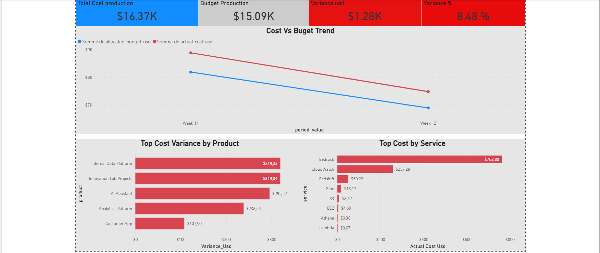
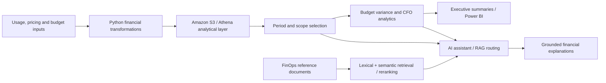

# CFO FinOps — Interactive AWS Financial Intelligence Assistant

**An AI-guided workflow that turns cloud cost and budget data into executive financial insights.**

CFO FinOps is an interactive financial analysis application I built to help a CFO or finance stakeholder explore AWS spending without having to navigate technical billing data directly. The assistant guides the user through choosing a reporting period, preparing a Power BI review, interpreting cost and budget results, and asking a final strategic FinOps question.

The experience brings together **Python, AWS Athena, Amazon S3, Power BI, and retrieval-augmented generation (RAG)**. Financial figures come from the analytics layer; AI helps guide the interaction and explain the results.

## Watch the working demonstration

[](https://www.youtube.com/watch?v=ng4qtWeyZ2M)

**[▶ Watch the CFO FinOps assistant in action (YouTube)](https://www.youtube.com/watch?v=ng4qtWeyZ2M)**

The demonstration walks through period selection, a guided **manual Power BI refresh**, a narrated financial dashboard review, and a strategic CFO question.



## 1. The business problem

Finance leaders need to understand more than the total AWS bill. They need to see **which products and business units drive costs, where actual spending diverges from budgets, and which issues deserve attention first**.

The difficulty is connecting technical cloud usage and financial data to an executive workflow that is easy to navigate and explain. CFO FinOps addresses that problem by connecting structured calculations, visual reporting, and an AI-guided conversation.

## 2. How the assistant works

The video demonstrates this sequence:

1. **Guided onboarding:** The assistant welcomes the user and explains the financial analysis process.
2. **Reporting-period selection:** The user can work by **days, weeks, or months**. Selection rules enforce valid periods, including consecutive weeks and a special first-week shutdown window.
3. **Dashboard preparation:** The assistant offers a refresh workflow. In the demonstration, the user selects **manual refresh** and is guided through Power BI before continuing.
4. **Financial walkthrough:** For the selected period, the assistant discusses cost variance by product, cost by AWS service, actual cost versus budget, and spending trends.
5. **Executive priorities:** The walkthrough draws attention to the main financial and technical cost drivers that warrant investigation.
6. **Strategic Q&A:** The user asks a final CFO-level question and receives a structured FinOps explanation focused on governance, visibility, budgeting, accountability, and business value.

### Example from the demonstration

The video selects **weeks 9 and 10** and reviews a Power BI dashboard. The narration highlights **Innovation Lab Projects** as a major product-level variance and **Amazon Bedrock** as a major service-level cost driver. It also discusses an **8.61% reported budget overrun** and identifies priorities for investigation. These are example figures from the demonstrated dataset, not a claim of savings achieved for an external customer.

### Main capabilities and their implementation

| Capability | What it does | Where to look |
|---|---|---|
| Guided analysis workflow | Walks the user through reporting periods and dashboard review | [`agent_entree_finopsrag.py`](agent_entree_finopsrag.py) |
| Financial analytics | Calculates spending, budgets, variances, and product/division comparisons | [`resolve_finops_analytics.py`](resolve_finops_analytics.py), [`finops_agent_athena.py`](finops_agent_athena.py) |
| AWS data access | Queries Athena and publishes reporting-oriented daily marts to S3 | [`build_athena_daily_marts.py`](build_athena_daily_marts.py), [`agent_entree_finopsrag.py`](agent_entree_finopsrag.py) |
| AI financial explanations | Routes financial questions and retrieves FinOps context with lexical/semantic search and reranking | [`cfo_final_router.py`](cfo_final_router.py), [`src/semantic_rag_general.py`](src/semantic_rag_general.py) |
| Executive reporting | Produces CFO summaries and supports Power BI dataset refresh workflows | [`generate_cfo_summary.py`](generate_cfo_summary.py), [`powerbi_refresh.py`](powerbi_refresh.py) |
| Testing and evaluation | Includes analytics and RAG evaluation harnesses | [`analytics_test_harness.py`](analytics_test_harness.py), [`rag_test_harness.py`](rag_test_harness.py), [`cfo_evaluation_suite.py`](cfo_evaluation_suite.py) |

## 3. System architecture



### Engineering design

- **Separate analytics from explanation.** Financial calculations and budget comparisons remain inspectable rather than being delegated to a language model.
- **Use retrieval to ground advice.** The RAG code includes lexical retrieval, embeddings, reranking, and prompts that explicitly restrict unsupported claims.
- **Support multiple reporting scopes.** The implementation contains product-level and division-level views and daily, weekly, or monthly selection logic.
- **Make cloud destinations configurable.** Athena query-output and daily-mart S3 locations are provided through environment variables and checked before use.
- **Keep the executive interface accessible.** Power BI and generated summaries translate analytical findings into finance-facing outputs.

## 4. Technology stack

| Layer | Technologies |
|---|---|
| Cloud and queries | AWS, Amazon S3, Amazon Athena, Boto3 |
| Data engineering | Python, Pandas, SQL |
| AI / retrieval | Retrieval-augmented generation (RAG), lexical search (BM25), sentence embeddings, reranking, language-model API |
| Reporting | Microsoft Power BI |
| Infrastructure | Terraform |

## 5. Running the project

The application runs in a configured environment with AWS resources, financial data, model access and Power BI credentials where needed.

**Prerequisites:** Python 3.11, a configured AWS environment with authorized Athena/S3 resources, required input data and tables, and any model or Power BI configuration used by the selected workflow.

```bash
python -m venv .venv
# Activate the virtual environment for your shell.
python -m pip install -r requirements.txt
```

Copy the non-secret variable names from [`.env.example`](.env.example) into your local environment. Do not commit credentials.

| Environment variable | Use |
|---|---|
| `AWS_PROFILE` | AWS credentials profile, where applicable |
| `AWS_REGION` | AWS region |
| `ATHENA_DATABASE` | Athena database |
| `ATHENA_WORKGROUP` | Athena workgroup |
| `ATHENA_RESULTS_S3` | S3 destination for Athena query results |
| `DAILY_MARTS_S3_BASE` | S3 destination for published daily marts |

Power BI operations also require tenant, client, workspace and dataset settings, plus appropriate permissions. Some auxiliary scripts contain environment-specific defaults; review them before running in another account. AWS queries, model requests, downloads, and Power BI refreshes may use external services and incur costs.

With the required environment and datasets configured, the principal application entry point is:

```bash
python agent_entree_finopsrag.py
```

See [`aws_config_validation.py`](aws_config_validation.py) for early validation of required S3 destination formats. The repository's Dockerfile packages Python dependencies but does not automatically provision AWS or Power BI services.

## 6. Code and evaluation

**Key project components:**

- Python implementation of analytics, Athena querying, retrieval, summaries and reporting integration.
- Evaluation harnesses: [`analytics_test_harness.py`](analytics_test_harness.py), [`rag_test_harness.py`](rag_test_harness.py), [`cfo_evaluation_suite.py`](cfo_evaluation_suite.py).
- Terraform definitions and a documented AWS configuration contract.
- An example dashboard screenshot from the project.

## 7. Environment requirements

- Cloud tables, local datasets, paths and access rights must match the intended environment.
- AI explanations are bounded by the quality and coverage of the retrieved documents; they are not an independent audit of financial accuracy.
- Some auxiliary modules still contain environment-specific configuration defaults and require review before reuse.
- Terraform provides infrastructure definitions; deployment requires the relevant AWS account and permissions.
- The application requires configured AWS, data, and reporting services to reproduce the demonstrated workflow in another environment.

## Project takeaway

**CFO FinOps combines an interactive AI assistant with AWS financial analytics and Power BI.** Its defining feature is the complete executive workflow: guide the user, select the analysis scope, review the financial evidence, explain the key findings, and support the next decision.

*Personal portfolio project by Felix Brillant.*
